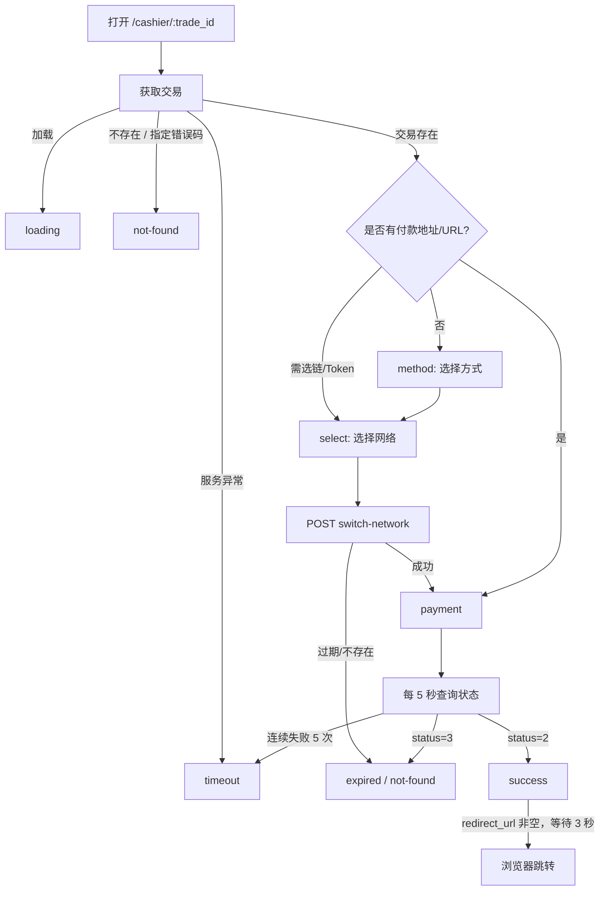

# 收银台状态机逆向规格（2026-11-03）

证据：`src/www/assets/_trade_id-B2s-YYlo.js`、`checkout-model-CU56hvYm.js`、`_trade_id-ygb9_KBy.js` 和 Go `src/route/router.go`。此处为静态 JS 取证，网络竞态、浏览器兼容和 Go controller 实际响应仍需联调。

## 公开路径及网络调用

| 节点 | 请求 | 条件/说明 |
|---|---|---|
| 初始化 | GET `/pay/checkout-counter-resp/{trade_id}` | 每次进入交易页面读取，不自动重试（`retry:false`） |
| 支付选项 | GET `/payments/gmpay/v1/config` | 有 trade_id 时启用；读取 `supported_assets` 与 OkPay 配置 |
| 切换/选择 | POST `/pay/switch-network` | `{trade_id, network:lowercase, token:lowercase}` |
| 轮询 | GET `/pay/check-status/{trade_id}` | 交易存在且未处于 loading/not-found/timeout 等前端状态时启用 |
| 凭证提交 | POST `/pay/submit-tx-hash/{trade_id}` | `{block_transaction_id}` |

## 状态流程



> Mermaid 为便于开发的**简化表示**；优先级、状态覆盖及错误码以实际代码和 Go 响应为准。代码中的页面状态还包括 `loading`、`method`、`select`、`payment`、`success`、`expired`、`timeout`、`not-found`。

## 原前端观察到的常量

`checkout-model-CU56hvYm.js`：

- 轮询间隔 `5000ms`（导出 `i`，被收银台导入为 `We`）。
- 成功后跳转延时 `3000ms`（导出 `a`，被收银台导入为 `Be`）。
- 找不到订单等错误码集合 `[10008,10013,404]`；过期错误码 `10010`。
- 获取异常码的兼容函数依次检查 `status_code`、`code`，还支持嵌套 `data`。
- `status=2`：成功；`status=3`：过期（仅此收银台轮询语义）。

## 返回数据模型（JS `checkout-model` 明确映射字段）

```ts
interface CheckoutOrder {
  trade_id?: string;
  amount?: number | string;
  actual_amount?: number | string;
  token?: string;           // 前端转大写显示
  currency?: string;        // 前端转大写显示
  network?: string;
  payment_url?: string;
  receive_address?: string;
  server_time?: string | number;
  expiration_time?: string | number;
  redirect_url?: string;
  created_at?: string | number;
  is_selected?: boolean | number | string;
  payment_type?: string;
  status?: number;
}
```

此 TS 类型只是逆向占位，不表示所有字段对所有支付方式都有效；需要检查 Go JSON 输出并在正式源码细分类型。

## 倒计时

- 前端以 `server_time` 为时间基准，同时保存 `performance.now()`；浏览器每秒更新逻辑展示用服务端时间加单调时间差的估算，避免简单依赖本地系统时钟。
- 截止时间取 `expiration_time`，跨数值/字符串时间戳进行兼容解析；Go buildCheckoutResponse 实际返回 Unix 毫秒，如果 `expiration_time` 存在而 `server_time` 缺失，前端会进入异常路径。
- 创建与过期时间能够形成有效间隔时采用该间隔，缺失时出现 600 秒作为显示比率的回退值（**不是服务端默认订单 TTL**）。

## 网络和特殊支付方式

- 可用链 Token 来自 `supported_assets[].{network,display_name,tokens}`。
- OkPay 选项受 `config.okpay.enabled`、`config.okpay.allow_tokens` 影响；已有 JS 显示针对 Tron 上 TRX/USDT 的映射。
- `switch-network` 成功后会更新本地订单快照；若返回新 `trade_id`，路由替换为新的 `/cashier/$trade_id`。
- 若返回 `payment_url` 且选择了 OkPay，可能弹出名为 `okpay_checkout` 的窗口；阻止弹窗、切换失败、父子订单及回跳仍需浏览器取证。
- 提交交易哈希成功且 `status===2` 会进入 success；否则刷新状态。

## 待核验的高优先级测试

1. 未选网络/已选网络、OkPay 启停、金额与收款地址正确性。
2. 本地时间不正确、server_time 缺失、订单已过期和网络中断。
3. 5 次失败后恢复是否能人工重试；页面销毁时是否停止计时器和请求。
4. 多次选择网络和多标签并发，旧响应覆盖新交易号的可能性。
5. 提交重复 tx hash、反复点击、重复回调、成功跳转取消及 3 秒延时。
6. 只有测试钱包和测试订单才允许执行端到端支付；不能用真实付款做逆向验证。

## 第五轮错误处理纠偏

原版将 10010 映射到 expired，但 Go errno 中 10010=OrderStatusConflict，不能直接推断过期。新实现建议重新 GET /pay/check-status/{trade_id} 决定成功、过期或其他状态；这是有意修正原版问题。
